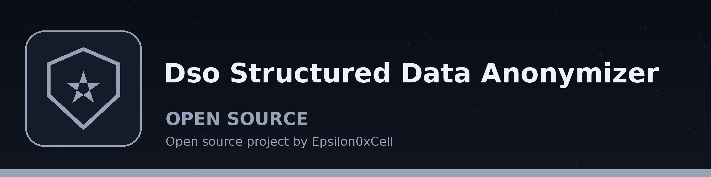

# dso-structured-data-anonymizer
Anonymizes structured data formats (JSON, CSV, XML) by replacing sensitive fields with configurable placeholder values based on field names or patterns, using `jq` or similar tools. - Focused on Tools for sanitizing and obfuscating sensitive data within text files and structured data formats

## Install
`git clone https://github.com/ShadowStrikeHQ/dso-structured-data-anonymizer`

## Usage
`./dso-structured-data-anonymizer [params]`

## Parameters
- `-h`: Show help message and exit
- `-f`: Format of the input data (json, csv, xml). Required.
- `-c`: Path to the JSON configuration file with field anonymization rules.
- `-v`: Enable verbose logging.

For XML, a rule anonymizes the text of elements matched by its path, and also any attribute value whose attribute name matches a rule key or the last element name in a rule path (for example a rule for `.//name` or `email` also covers an attribute named `name` or `email` on any element, including the root). A remove rule for an attribute deletes that attribute.

Errors in CSV and XML processing end the run at exit 1; no anonymized and saved line is printed and no output file is written for a failed run. A run that anonymizes zero values in any format exits 1. An empty CSV exits 1. For CSV, an output path that resolves to the input file is refused at exit 1, and the input is read fully before the output is opened.

## License
Copyright (c) ShadowStrikeHQ
